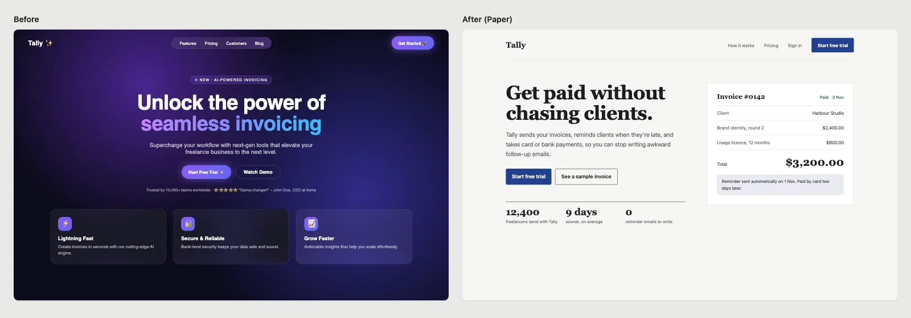
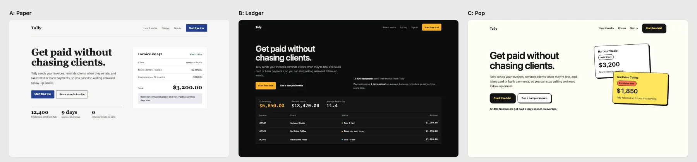

# pretty-ui

Make AI-built UI look designed, not generated.

pretty-ui is an agent skill for Codex, Claude Code, Hermes Agent and any agent that reads `SKILL.md`. Instead of patching a generic page with a list of rules, it does what a designer would do:

1. **Shows you three real design directions** for your own screen, side by side, built with your content.
2. **Saves the one you pick as `DESIGN.md`**, so every later screen follows the same colors, type and spacing.
3. **Applies it pass by pass** (layout, type, color, components, copy) across your pages or app screens.
4. **Checks the result for AI tells** with a small script: violet gradients, gradient text, glassmorphism, glow, emoji icons, filler copy, off-grid spacing and more.



It works for websites, web apps and mobile apps, in the stack you already use: HTML, Tailwind, shadcn/ui, React, Next.js, Vue, Svelte, React Native, Expo, SwiftUI, Jetpack Compose and Flutter.

## Install

**Codex**

```bash
codex plugin marketplace add ummydev/pretty-ui
codex plugin add pretty-ui@pretty-ui
```

**Claude Code**

```bash
/plugin marketplace add ummydev/pretty-ui
/plugin install pretty-ui@pretty-ui
```

**Hermes Agent**

```bash
hermes skills install ummydev/pretty-ui/skills/pretty-ui
```

**Any agent (skills CLI)**

```bash
npx skills add ummydev/pretty-ui
```

Or copy `skills/pretty-ui` into your agent's skills folder (`~/.codex/skills`, `~/.claude/skills` or `.agents/skills` in a project).

## Use

Ask in plain words:

- "Make this landing page look less AI-generated."
- "Pick a design system for my app and show me three directions."
- "Redesign this dashboard and keep our brand colors."
- "Polish the onboarding screens of my Expo app."

The skill reads your project, audits what is there, builds three directions with your real content, and opens a comparison page so you can choose. Nothing is restyled until you pick.



## What it does differently

| | Rule lists | pretty-ui |
|---|---|---|
| Who chooses the style | The agent | You, from three rendered options |
| Where the choice lives | Nowhere, so the next screen drifts | `DESIGN.md` in your repo |
| Existing brand | Often overwritten | Kept; directions vary inside it |
| Apps and dashboards | Mostly landing pages | Web apps and mobile apps have their own rules (`references/app.md`) |
| Proof | "Looks better" | A checker run before and after |

It ships 24 ready-made design systems (`references/systems.md`), each with a palette checked for contrast and a font pairing that is not Inter. Browse them with previews at [codexdesign.io/design-systems](https://codexdesign.io/design-systems).

## The checker

```bash
node skills/pretty-ui/scripts/check.mjs src/
```

Node 18+, no dependencies. It scans HTML, CSS, JSX, TSX, Vue, Svelte and Astro files and exits 1 when it finds errors.

On the example page in `examples/before/tally.html` it reports 12 errors and 12 warnings. The three directions in `examples/directions/` report none.

To compare screens side by side:

```bash
node skills/pretty-ui/scripts/compare.mjs a.html b.html c.html --labels "A,B,C"
```

## How it compares

- [Taste Skill](https://github.com/Leonxlnx/taste-skill) gives the agent strong art direction and a house style. pretty-ui lets you choose the style and writes it down.
- [Impeccable](https://github.com/pbakaus/impeccable) is a set of design commands with a detector. pretty-ui is one guided run, from choosing a direction to checking the result.
- [UI UX Pro Max](https://github.com/nextlevelbuilder/ui-ux-pro-max-skill) is a large searchable style database. pretty-ui keeps a short, curated list and builds the options for you to see.

They work fine together. We wrote longer comparisons on [codexdesign.io](https://codexdesign.io/guides/anti-ai-slop-design-skills).

## Files

```
skills/pretty-ui/
  SKILL.md              the run, step by step
  references/tells.md   AI tells and what to do instead
  references/app.md     rules for web app and mobile app screens
  references/systems.md 24 design systems with colors and fonts
  scripts/check.mjs     the AI-tell checker
  scripts/compare.mjs   side-by-side comparison page
examples/               the Tally before page and three directions
```

## Related

- [design-md](https://github.com/ummydev/design-md): the 24 design systems as `DESIGN.md` files and a shadcn theme.
- [ui-templates](https://github.com/ummydev/ui-templates): full app templates with source.
- [Codex Design](https://codexdesign.io): a canvas for designing with Codex and Claude Code.

## License

MIT
